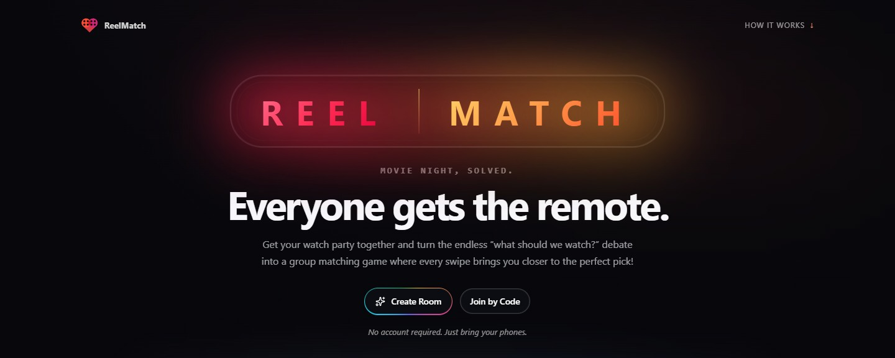
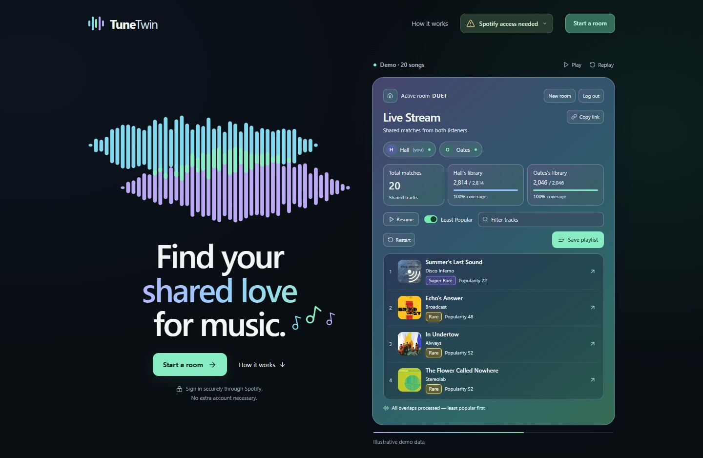

# Beau

I build full-stack web apps with Python and JavaScript. My recent work includes real-time rooms, movie search, and integrations with paginated APIs.

## ReelMatch

A real-time movie picker for groups. Everyone swipes from their phone on movies the room can stream through its selected services.

**Stack** · Next.js, TypeScript, FastAPI, PostgreSQL

[Try ReelMatch](https://reelmat.ch/) · [Quick start and case study](projects/reelmatch.md)

## TuneTwin

TuneTwin compares two Spotify libraries and shows the songs they share as the scan runs. Listeners can find their shared deep cuts and save the matches as a playlist.

**Stack** · React, Vite, Python, Flask, Spotify Web API

[Try the built-in demo](https://tunetw.in/) · [Quick start and case study](projects/tunetwin.md) · [Comparison reader code](https://github.com/beaubl/tunetwin-comparison-sample)

