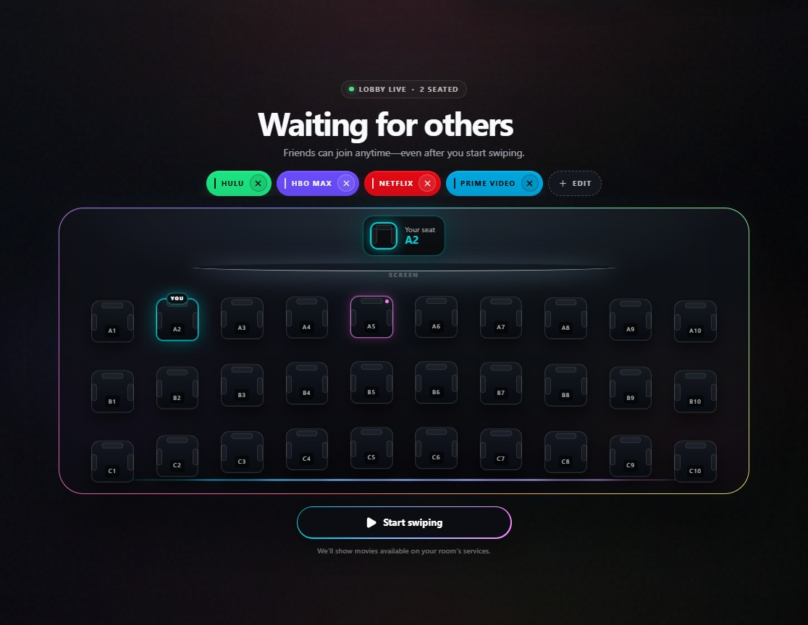
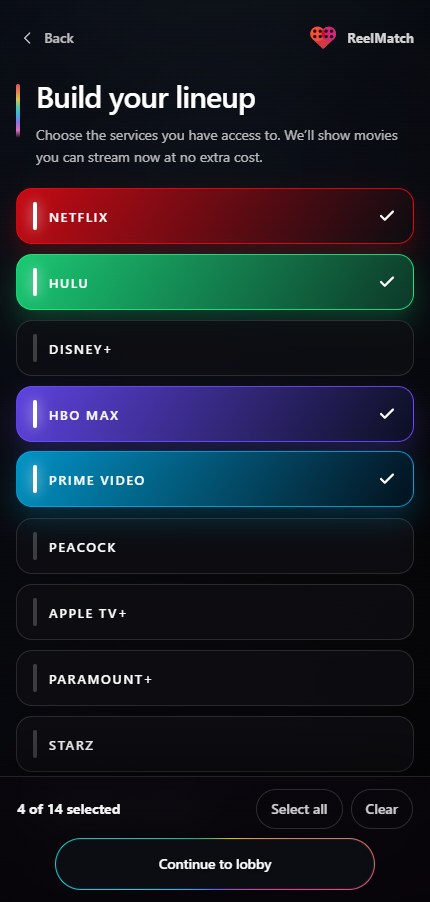
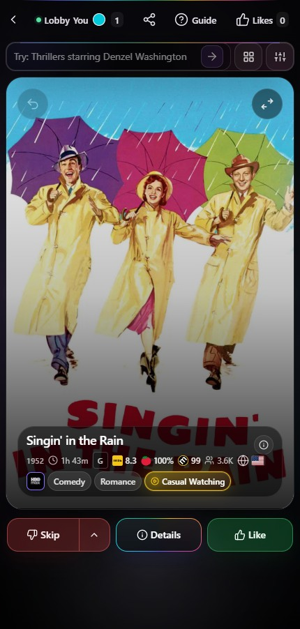

# ReelMatch

ReelMatch turns choosing a movie into a shared swipe session. Everyone votes from their phone. The deck draws on the U.S. streaming services the room can access.

[Try ReelMatch](https://reelmat.ch/) · [Quick start](#quick-start) · [Engineering notes](#engineering-notes)

## Quick start

**On your own**

1. Select **Create Room**. No account is required.
2. Pick your streaming services and select **Continue to lobby**.
3. Select **Start swiping**. Tap **Like** or **Skip** on a movie, or use the search box above the deck to look up a title.

**With a friend**

1. Create a room and choose your services. Share the invite link or room code from the lobby.
2. On a second device, open the invite or use **Join by Code**. Review the streaming services and continue to the lobby.
3. Start swiping. In a default room, a movie becomes a match once everyone likes it.

## Inside ReelMatch

**A shared room.** The lobby shows the group’s streaming services and each player’s seat. The two lit seats below are from separate browser sessions in the same room.

**From the phone.** Choose streaming services, then vote on the movies the room can watch.

  
  

## Engineering notes

### A retry should count as one vote

A phone can lose its connection after the server saves a vote. Each retry carries the original transaction ID so the server can recognize the same action. Votes and tallies are stored in PostgreSQL, and clients use versioned room updates to reconcile what they display.

### The wait between a swipe and the next poster

Bundling the next card with the vote response saved a request. On a cold cache, the browser still waited for that response before downloading the poster. We tried loading up to three likely posters during the time someone spent looking at the current card. The vote still determined which card came next.

One pass warmed a 500-pixel image while the card asked for a 780-pixel version. Those were different URLs, so we made the preloader and card use the same one. In one Chromium run with simulated delays, loading the artwork ahead of time cut swipe-to-poster time from **1,136 ms to 536 ms**. Each case fetched the image once.

### Who gets a say in the next 30 movies?

We tried scoring movies by combining the group average with the score of the least interested person. In a four-person test room, one player’s acceptable picks went from nine out of 30 to six. The next design started with the original deck and tried swaps from the same pool of eligible movies. Each swap had to preserve the mix of movies, improve at least one person’s estimated fit, and keep everyone else’s score at least as high.

Compared with the original deck, the revised deck held that player at nine acceptable picks and raised the number of movies marked acceptable by all four profiles from **one to five out of 30**. The test room with no overlap in tastes stayed at zero. The offline tests used scripted tastes and predefined judgments for each movie.

## Tech stack

| Layer | Technology |
| --- | --- |
| Frontend | Next.js, React, TypeScript, Tailwind CSS, Framer Motion |
| API and persistence | Python, FastAPI, PostgreSQL, SQLAlchemy, Alembic |
| Room synchronization | WebSockets, with server-sent events and polling fallbacks |
| Search support | Redis for caching and search coordination |

Screenshots are from a running ReelMatch preview. Movie data and artwork by TMDB. Streaming availability by Movie of the Night (SAvA).
