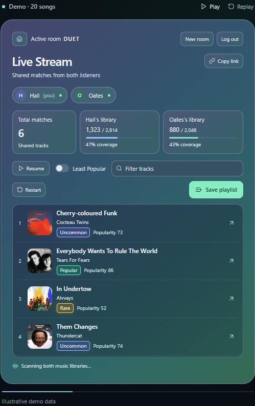
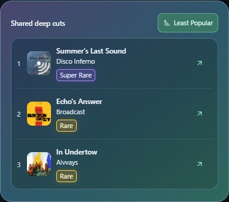

# TuneTwin

TuneTwin finds the songs two people have in common across their Spotify liked songs and playlists. Matches appear during the scan, and listeners can sort them by popularity or save a shared playlist.

[Open TuneTwin](https://tunetw.in/) · [Quick start](#quick-start) · [Design decisions](#design-decisions)

## Quick start

**Try the homepage demo**

1. Select **Replay** above the **Live Stream** card. Watch the shared tracks appear while the two libraries are still being scanned.
2. Select **Pause** to stop at any point and inspect the matches.
3. Scroll to **Shared deep cuts** and select **Least Popular** to bring the lesser-known tracks to the top.

**Compare your own music**

Select **Start a room**, connect Spotify, and send a friend the room link. Once both listeners connect, you can compare your libraries and save the shared tracks to Spotify. The **Spotify access needed** notice explains how to request access for your account.

## Inside TuneTwin

**During the scan.** The example has found six shared tracks. Each listener can see how much of their library has been read.

  

**Find a deep cut.** The mobile example shows shared tracks after choosing **Least Popular**.

  

The screenshots show sample libraries and illustrative scores from TuneTwin’s public homepage.

## Design decisions

### Putting the comparison next to the headline

We first tried a centered waveform and headline with the room demo underneath. In the next version, the demo moved beside the headline so visitors could see what a comparison looks like as soon as they landed. The first side-by-side version gave the demo the wider column. We adjusted the split to give the waveform and title more room and kept the single-column layout on phones. The two colored waves represent the listeners. Green appears where they overlap.

### When one song looked like 100 percent

Early in a scan, TuneTwin could read one liked song and show 100% coverage because the playlists hadn’t been counted yet. We held the percentage until each listener’s library total was confirmed. Matches could still show up as they were found.

That made **Counting library** linger for someone with a long liked-songs list. The next version alternated pages of liked songs with pages that list playlists and their sizes. In one regression test, the scan confirmed a library of **1,250 entries** before it finished reading the **1,000 liked songs**.

### Which release counts as a deep cut?

The same song can have different Spotify popularity scores on a single, an album, and a reissue. We chose the highest verified score across releases of an already matched recording, using the recording’s ISRC to check which versions belong together.

The first version waited for the library scan to finish before checking other releases. We moved those checks into the scan so a result could start with the best score already found in either library and update as catalog results came in. The scan checks one catalog page per advancing poll and rotates through tracks with pending lookups so a long search for one recording doesn’t hold up the others.

## Tech stack

| Layer | Technology |
| --- | --- |
| Web app | React, JavaScript, Vite, Framer Motion |
| Backend | Python, Flask, SQLite for room presence |
| Music integration | Spotify OAuth and Spotify Web API |

The public comparison reader sample includes the coverage logic, result paging, and regression tests that run with synthetic data. [TuneTwin comparison reader](https://github.com/beaubl/tunetwin-comparison-sample)
